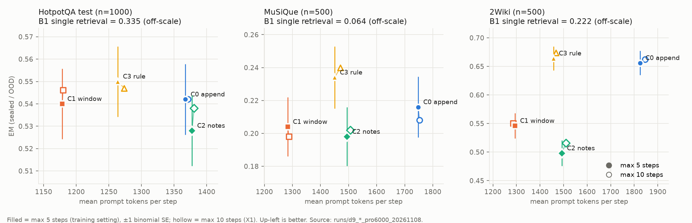

# StatefulSearch-RL

[简体中文](README.md) · **English**

<p align="center">
  
</p>

StatefulSearch-RL studies what a multi-hop search agent should carry forward between retrieval rounds. It compares four context policies under the same step-level GRPO setup. The policies use full retrieval history, a sliding window, model-written evidence notes, or rule-based compression.

## Key findings

- **Rule-based compression shortened prompts while retaining cross-round evidence.** Compared with full history, it used 7.5–20% fewer prompt tokens per step across three benchmarks. On 2WikiMultiHopQA, it also used 11% fewer prompt tokens per question, with 66.4% answer exact match (EM) versus 65.6% for full history. On HotpotQA and MuSiQue, extra search rounds increased total prompt tokens per question by 5–6%.
- **Evidence retention mattered most on questions requiring multiple retrieval rounds.** On 2WikiMultiHopQA, the sliding window and model-written notes scored 11–17 percentage points below full history and rule-based compression. Trajectory analysis showed repeated queries and more runs exhausting the step budget before answering. Increasing the cap from 5 to 10 steps changed EM by at most 1.8 percentage points.
- **Process rewards changed note-taking behaviour.** With answer EM as the sole reward, the share of training rollouts containing notes fell from 10.6% to 4.4%. A reward for notes citing supporting documents raised note use to 29.8% of rollouts at steps 31–40, compared with 6.0% under the outcome-only reward. The matched 80-step checkpoints showed no statistically significant EM difference across the three benchmarks.

## Experimental setup

- **Training.** Qwen3-4B-Instruct-2507 with LoRA (rank 32, alpha 32) on [Agent-R1](https://github.com/AgentR1/Agent-R1) and veRL 0.7.0. The four main runs shared the training data, hyperparameters, 150-step budget, and answer EM reward.
- **Evaluation.** Used HotpotQA for training and checkpoint selection (500 dev questions), plus a held-out 1,000-question test set. MuSiQue and 2WikiMultiHopQA contributed 500 out-of-distribution evaluation questions each.
- **Scope.** The main comparison uses one training seed per policy. The dev checkpoint re-evaluation scored 1.8 percentage points below its training-time score. Small differences should be interpreted in that context.

| Benchmark | C0 Full history | C1 Sliding window | C2 Model-written notes | C3 Rule-based compression | B1 Single retrieval |
|---|---:|---:|---:|---:|---:|
| HotpotQA test (1,000) | 0.542 / 1,367 | 0.540 / 1,179 | 0.528 / 1,377 | 0.550 / 1,264 | 0.335 |
| MuSiQue (500) | 0.216 / 1,748 | 0.204 / 1,283 | 0.198 / 1,494 | 0.234 / 1,450 | 0.068 |
| 2WikiMultiHopQA (500) | 0.656 / 1,825 | 0.546 / 1,293 | 0.498 / 1,492 | 0.664 / 1,458 | 0.280 |

Each policy cell reports answer EM and mean prompt tokens per step. The single-retrieval baseline reports EM only. See the [evaluation card](docs/experiment_cards/d9_sealed_eval.md) for the scoring protocol and paired tests.



## Implementation

- Extended Agent-R1 with [pluggable context policies](src/ssrl/context_policies.py), a [citation-based note tool](src/ssrl/env_search.py), and a [note process reward](src/ssrl/note_bonus.py). The upstream submodule is pinned to `b124aa4`.
- Checked rollout and training log-probability agreement, step-level advantage assignment, trajectory replay, and checkpoint resume.
- Fixed multi-GPU metric aggregation and duplicate entries in rollout logs. Submitted the fixes upstream as [Agent-R1 #113](https://github.com/AgentR1/Agent-R1/pull/113) and [#114](https://github.com/AgentR1/Agent-R1/pull/114).
- Built out-of-distribution retrieval indexes and analysed results by retrieval depth, failure mode, and note quality.

## Reproduction

Experiments ran on AutoDL with RTX PRO 6000 96 GB GPUs. The [GPU setup guide](env/GPU_ENV.md) and [dependency constraints](env/autodl/constraints.txt) cover the tested environment. The scripts assume `/root/autodl-tmp/stateful-search-rl` for the checkout and `/root/autodl-tmp/data` for data and models.

```bash
bash scripts/autodl/setup_env.sh
bash scripts/autodl/e_preflight.sh

# Skip the post-training shutdown. The MAX_HOURS hard limit still applies.
touch /root/autodl-tmp/NO_SHUTDOWN
bash scripts/autodl/e_run.sh c0 c1 c2 c3
bash scripts/autodl/d9_eval.sh all
```

The [local Conda environment](env/environment-local.yml) supports CPU-only analysis of saved runs. The evaluation card documents the retrieval corpora and index construction for the two out-of-distribution datasets.

```bash
python -I scripts/analyze_d9.py runs
python -I scripts/plot_d9.py runs
python -I scripts/plot_dynamics.py runs
python -I scripts/rollout_dynamics.py runs
```

## Further reading

- [Full report (Chinese)](docs/REPORT.md)
- [Experiment cards](docs/experiment_cards/) for the [four-policy comparison](docs/experiment_cards/e0_e3_main.md), [note quality audit](docs/experiment_cards/d10_rq2_note_quality.md), and [process reward](docs/experiment_cards/e4_e5_candidates.md)
- [Data split manifests](data/manifests/)
