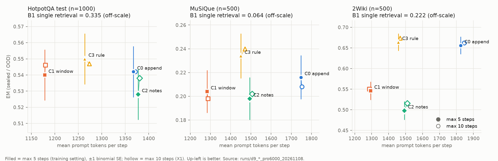

# StatefulSearch-RL

**简体中文** · [English](README.en.md)

<p align="center">
  
</p>

多跳搜索 Agent 的上下文管理强化学习：在 GRPO 训练中把「每一步的上下文怎么构造」作为唯一变量，比较 append / 滑窗 / 模型自写证据笔记 / 规则压缩四种策略，回答 **RL 能否教会模型自己提炼证据、在更少 token 下保持准确率**。

- 底座：[Agent-R1](https://github.com/AgentR1/Agent-R1)（veRL 0.7.0，step-level MDP），`third_party/` 固定 SHA `b124aa4`，改动以 patch 记录
- 模型：Qwen3-4B-Instruct-2507 + LoRA（r32 / α32），奖励只用 EM
- 数据：HotpotQA（训练 / dev 500 / 封存 test 1000）；MuSiQue 500、2Wiki 500 只评测
- **完整报告：[`docs/REPORT.md`](docs/REPORT.md)**；计划 `docs/PLAN.md`；实验卡 `docs/experiment_cards/`；进度 `docs/PROGRESS.md`

## 结果一览

| EM / 每步 prompt token | C0 append | C1 window | C2 notes | C3 rule | B1 单次检索 |
|---|---|---|---|---|---|
| HotpotQA 封存 test（1000） | 0.542 / 1367 | 0.540 / 1179 | 0.528 / 1377 | **0.550 / 1264** | 0.335 |
| MuSiQue（500） | 0.216 / 1748 | 0.204 / 1283 | 0.198 / 1494 | **0.234 / 1450** | 0.068 |
| 2Wiki（500） | 0.656 / 1825 | 0.546 / 1293 | 0.498 / 1492 | **0.664 / 1458** | 0.280 |

run_id：`d9_<数据集>_<组>_q3-4b-2507_lora_pro6000_20261108`（实验卡 `docs/experiment_cards/d9_sealed_eval.md`）。

- HotpotQA 上四组 EM 持平（约 74% 的题 C0 一步就作答，策略不起作用）；**差距几乎全部出在需要跨轮拼证据的题上**：2Wiki 上 C1 / C2 比 C0 / C3 低 11–17pp（McNemar p < 1e-7），原因是丢掉旧证据后重复检索、步数耗尽。
- **规则压缩 C3 与 C0 的 EM 持平，每步上下文短 7.5–20%**；但它多搜几轮，按每题总 token 只在 2Wiki 上更省（−11%），HotpotQA / MuSiQue 上多 5–6%。
- **只用 EM 奖励时 RL 没学会记笔记**：有笔记的训练轨迹比例 10.6% → 4.4%；笔记本身基本忠实（幻觉约 2%），RL 后更贴原文，但引用支撑文档的比例下降（0.86 → 0.75；DeepSeek / Gemini 双 judge，另有 Claude 盲审和作者人工复核各 30 条）。
- **加上笔记过程奖励（E4）后，模型学会了写笔记，但准确率没上来**：写笔记的轨迹 10% → 33%，但与 E2 同为 80 步相比 EM 无显著差别（2Wiki 0.472 vs 0.452，p=0.22；离 C0 / C3 约 0.66 仍远）。
- 放宽步数上限 5 → 10 不能弥补丢证据。
- 限制：单 seed；评测环境复测 dev 比训练时低 1.8pp（在预设门槛内）；token 为每步 prompt 平均值。详见报告第 6 节。



## 我们做了什么（相对上游）
| 来自 Agent-R1 / veRL | 本项目 |
|---|---|
| step-level rollout、GRPO 训练器、vLLM 推理、HotpotQA recipe、检索工具 | 可插拔上下文策略层 C1 / C2 / C3 与 `note` 工具协议（`src/ssrl/context_policies.py`、`src/ssrl/env_search.py`） |
| | 训推 logprob 一致性检查、逐步优势广播对拍、严格轨迹回放、续训一致性检查（`src/ssrl/checks/`、`tests/`、`scripts/check_*.py`） |
| | 多卡路径 3 个问题的修复（`third_party/patches/`，已提交上游 [#113](https://github.com/AgentR1/Agent-R1/pull/113)、[#114](https://github.com/AgentR1/Agent-R1/pull/114)） |
| | 封存评测、OOD 检索库构建、配对检验 / 分层 / 失败模式分析、笔记质量评估、训练动力学（`scripts/`） |

## 复现

环境：AutoDL RTX PRO 6000 96GB（西北B），私有镜像或 `scripts/autodl/setup_env.sh` 从零搭建（torch 2.9.0+cu129 / vLLM 0.12.0 / verl 0.7.0，版本锁在 `env/autodl/constraints.txt`，说明见 `env/GPU_ENV.md`）。仓库放在 `/root/autodl-tmp/stateful-search-rl`，数据和模型在 `/root/autodl-tmp/data`。

```bash
# 1. 环境 + 数据 + 模型（可重复执行）
nohup bash scripts/autodl/setup_env.sh > /root/autodl-tmp/setup_env.log 2>&1 &

# 2. 预检：冒烟 + 严格回放 + 续训检查 + 批大小校准
nohup bash scripts/autodl/e_preflight.sh > /root/autodl-tmp/e_preflight.log 2>&1 &

# 3. E0–E3 训练（每组 1 卡、多组并行；跑完自动关机，touch /root/autodl-tmp/NO_SHUTDOWN 取消）
nohup bash scripts/autodl/e_run.sh c0 c1 c2 c3 > /root/autodl-tmp/e_run.log 2>&1 &

# 4. D9 封存评测：建 OOD 索引 → dev 一致性检查 → 四组 × 三数据集 × {5, 10} 步 → B0/B1
nohup bash scripts/autodl/d9_eval.sh all > /root/autodl-tmp/d9.log 2>&1 &
```

本地分析（不需要 GPU，conda 环境 `env/environment-local.yml`）：

```bash
python -I scripts/analyze_d9.py runs        # 配对检验、分层、失败模式、F1 / 别名 EM
python -I scripts/plot_d9.py runs           # 帕累托图、按轮数分层图
python -I scripts/plot_dynamics.py runs     # 训练动力学
python -I scripts/rollout_dynamics.py runs  # 零方差组、重复检索、笔记率
python -I scripts/rq2_note_quality.py extract && python -I scripts/rq2_note_quality.py judge --judge deepseek && python -I scripts/rq2_note_quality.py report
```

OOD 数据：`scripts/make_ood_splits.py` 从 Agent-R1-data 的验证集各抽 500 题（manifest 在 `data/manifests/`）；MuSiQue 检索语料用上游 `build_retrieval_corpus.py` 从官方 jsonl 重建，2Wiki 用上游发布的语料，两者都用 `build_index.py` 建索引（见 D9 实验卡）。

## 目录
```
third_party/      上游 Agent-R1（submodule，固定 SHA）+ patches/
src/ssrl/         上下文策略、搜索 flow、一致性检查
configs/flows/    C0–C3 及放宽步数（_x1）的 flow 配置
scripts/          训练 / 评测 / 分析脚本（autodl/ 为实例内脚本）
tests/            单元测试
docs/             报告、计划、实验卡、分析、图、进度
data/manifests/   数据划分 ID 与 hash
env/              本地与 GPU 环境说明
```
