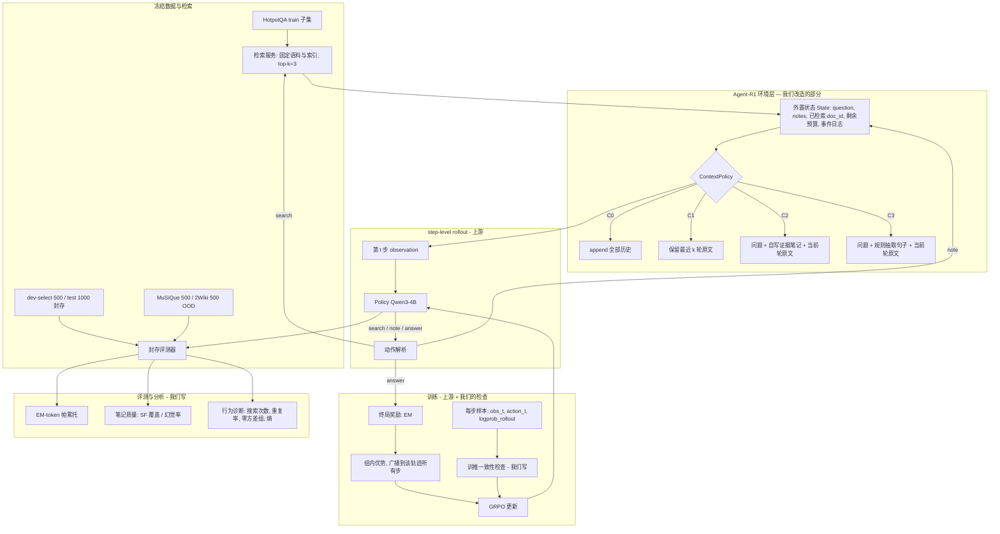

# StatefulSearch-RL v3：多轮搜索 Agent 的上下文管理强化学习

> 版本：2026-11-02 v3（Claude 定稿版，整合 GPT v1 的实验纪律与 Gemini v2 的落地节奏）
> 定位：主项目。两周，与副项目 AgenticVerifier-Code 并行。
> 状态：**尚未运行任何实验。本文不包含任何预期数字**；所有结果位在实验完成后由日志回填。

---

## 0. 一页纸总结

| 项 | 内容 |
|---|---|
| 一句话 | 在多跳搜索 Agent 的 RL 训练中，把"上下文怎么管理"作为实验变量，回答：**RL 能否教会模型自己提炼证据，在更少 token 下保持或提升准确率？** |
| 底座 | **Agent-R1（veRL 0.7.0，step-level MDP）**。Day 1 跑不通则退回 Search-R1 |
| 模型 | Qwen3-4B-Instruct-2507（部署时核验 revision） |
| 任务 | HotpotQA 训练；HotpotQA 封存测试 + MuSiQue / 2Wiki 做难度外推 |
| 核心对照 | C0 append（原版）/ C1 sliding window / C2 模型自主 curate 证据 / C3 规则压缩（控制组） |
| 你自己的东西 | ① 可插拔的上下文策略层与 curate 协议；② 训推一致性和逐步优势的正确性验证；③ 准确率–token 帕累托、curate 质量和行为诊断三类分析 |
| 算力 | GCP A100 80GB 为主（2–4 卡），Colab A100/G4 做开发，TC2 备用 |
| 两周交付 | 可复现仓库 + 4 组主对照 + 封存测试结果 + 分析报告 + 真实数字的简历 bullet |

---

## 1. 整体思考：为什么是这个项目、这样做

### 1.1 和参考简历的差异化
收集到的参考简历里，搜索 Agent 项目有两类：
- **"Search-R1 复现 + 改进"**：价值在跑通 + 修崩溃 + 性能剖析，但研究问题不清晰；"训练批次内峰值 81.2%"这种口径还会被追问。
- **"SFT 初始化分布对搜索 RL 的影响"**：问题清晰、行为评测体系完整，但没有成本维度。

本项目选了第三个变量：**上下文管理**。它满足四个条件：
1. **问题是真的**：多轮 Agent 的上下文膨胀是公认问题，MemAgent、harness-1、RAGEN 都在做。
2. **有两个维度**：准确率 × token 成本，能画帕累托图，天然比单一 EM 数字更有说服力。
3. **工程上有深度**：每轮上下文不同，意味着训练样本是逐步的，涉及 logprob 一致性和优势分配。这正是参考简历里 τ²-bench 那份最有分量的部分。
4. **负结果也有价值**：如果 curate 在 2 跳题上不涨点、只省 token，这本身就是一个可以讲清楚的结论。

### 1.2 为什么底座选 Agent-R1，而不是 Search-R1
- Search-R1 和 veRL 原生 agent loop 都是 **"一条轨迹一个拼接序列"**，环境返回用 mask 遮住。如果在第 t 轮丢掉前面的文档，第 t 轮动作的真实条件上下文就和拼接序列不一致，重算的 logprob 就是错的。要改它，就得自己做逐轮样本，风险集中在最难的地方。
- Agent-R1 当前版本（基于 veRL 0.7.0）以 step 为基本单位，由环境决定下一步 observation，历史可以 append、截断、摘要或重写。**最难的底层已经存在**，我们把精力放在策略、验证和分析上。
- 风险是 Agent-R1 的新版用户少，坑可能更多。所以 Day 1 设 go/no-go，见 §8。

### 1.3 "自己的东西"边界（面试时要说得清清楚楚）
| 来自上游 | 我们自己做的 |
|---|---|
| step-level rollout、GRPO/PPO 训练器、vLLM 推理、HotpotQA recipe | 上下文策略层（C1/C2/C3）和 curate 动作协议 |
| 检索服务（Agent-R1 自带或借用 Search-R1 的 retriever） | 训推 logprob 一致性检验工具、逐步优势广播的单元测试 |
| 基础指标 | Pre-GRPO probe、行为诊断、curate 证据质量评估、帕累托分析、OOD 外推评测 |

**面试话术原则**：说"基于 Agent-R1 的 step-level 框架，我实现了……并验证了……"，不说"我从零搭了一个多轮 RL 框架"。

---

## 2. 研究问题与假设

- **RQ1（帕累托）**：同模型、同数据、同 rollout 数量下，C0–C3 在 EM 和每题 token 成本上的帕累托关系如何？
  - H1：C2 的每题输入 token 显著低于 C0；EM 差距在置信区间内，或优于 C0。
- **RQ2（RL 是否学会了提炼）**：RL 训练前后，C2 写下的证据笔记质量是否提升？
  - 指标：笔记对 HotpotQA supporting facts 的覆盖率；笔记能否被检索原文支持（幻觉率）；笔记质量与答对的相关性。
  - **对照 C3（规则压缩）**：如果 C3 和 C2 一样好，说明收益来自"压缩"而不是"学会提炼"。
- **RQ3（难度外推）**：在更多跳的 MuSiQue / 2Wiki 上，或把最大轮数放宽到训练时的 1.5–2 倍时，各策略的差距是否拉大？
- **RQ4（训练动力学）**：各策略的零方差组比例、熵、搜索次数分布、重复 query 率、轨迹长度如何演化？是否出现坍缩？

**不预设任何提升幅度**。最小成功标准是：4 组可信对照 + 封存测试 + 包含负结果的报告。

---

## 3. 系统架构



### 3.1 动作协议
```
<think> ... </think>            # 可选，计入 loss
<search> query </search>        # 触发检索，计入 loss
<note> 1-3 条事实, 每条带 [doc_id] </note>   # 仅 C2 启用，计入 loss
<answer> ... </answer>          # 终局，计入 loss
<information> ... </information> # 环境返回，不是 policy 生成的 token
```
- 每条 note 必须带来源 `doc_id`，方便评估幻觉。
- 预算：最多 4 次 search，最多 6 步，单步输出 ≤ 512 token。超预算则强制结束，奖励为 0，并记录 `truncated`。

### 3.2 四种上下文策略（核心实现，约 150–250 行加单元测试）
| 策略 | 第 t 步 observation | 要点 |
|---|---|---|
| C0 append | 问题 + 全部历史动作 + 全部历史文档 | 原版基线 |
| C1 window | 问题 + 最近 k 步的动作和文档（k 让平均 token 与 C2 接近） | 区分"少看点就行"和"学会提炼" |
| C2 curate | 问题 + 累积 notes + 历史 search query 列表 + **仅本轮**文档 | notes 是 policy 动作，被 RL 直接优化 |
| C3 rule | 问题 + 规则抽取的高重叠句子 + 历史 query + 本轮文档 | 不靠学习的压缩对照 |

**公平性原则**：
- C0–C3 共用同一模型、数据、G、步数、检索 top-k 和最大轮数，奖励只有 EM。
- 如需 SFT 冷启动，四组必须用**同源、同规模**的 SFT 数据，不能只给 C2 做 SFT。

---

## 4. 代码结构与模块所有权

```text
stateful-search-rl/
  third_party/Agent-R1/          # git submodule，固定 SHA，原则上不改；必须改的地方用 patch 文件记录
  src/ssrl/
    context_policies.py          # C0-C3       [owner: Claude 设计 → 实现 → 你审读]
    actions.py                   # 动作解析与校验 [owner: Gemini Argon，Claude 审查]
    state.py                     # 外置状态与事件日志，可回放
    env_search.py                # 对接 Agent-R1 的 ToolEnv / AgentEnv
    rewards.py                   # EM / F1 规范化
    checks/logprob_consistency.py  # 训推一致性     [owner: Claude]
    checks/step_advantage.py       # 优势广播检查   [owner: Claude]
    diagnostics.py               # 零方差组、熵、搜索次数、重复率 [owner: GPT]
    eval/run_eval.py             # 封存评测       [owner: GPT]
    eval/note_quality.py         # SF 覆盖、幻觉率 [owner: Gemini Argon]
  configs/{smoke,probe,c0,c1,c2,c3}.yaml
  scripts/{setup_gcp.sh, launch_retriever.sh, train.sh, eval.sh, probe.sh}
  tests/  test_context_policies.py  test_mask.py  test_logprob.py  test_resume.py
  reports/ experiment_cards/  figures/  final_report.md
  data/manifests/                # split ID 列表 + hash
```

---

## 5. 数据与评测协议

- **训练**：HotpotQA train 中抽 5k–10k 题（按 Agent-R1 recipe 的数据处理，保留原始 ID）。
- **dev-select**：500 题，从官方 dev 抽，只用于选 checkpoint。
- **test**：1000 题，从官方 dev 中与 dev-select 互斥抽取。**封存**，配置冻结后只跑一次。
- **OOD**：MuSiQue-Ans dev 500、2WikiMultihopQA dev 500。只评测，不训练。
- **检索**：Day 1 定下语料和索引（优先 Agent-R1 recipe 自带的；否则用 Search-R1 的 e5 + wiki-18 retriever），之后全程冻结。
- **checkpoint 选择**：每 20 步在 dev-select 上做 greedy 快评，按 EM 选。规则预先写进 `experiment_cards/`。
- **统计**：
  - test 上做题目配对 bootstrap，给出 95% 置信区间；
  - 预算允许时 C0 和 C2 补第 2 个 seed，seed 差异单独报告；
  - **不报训练 batch 内峰值，只报封存测试**。

---

## 6. 指标

| 类别 | 指标 |
|---|---|
| 质量 | EM、F1；按跳数和题型分层 |
| 成本 | 每题总输入 token（所有步的 prompt 之和）、每步峰值上下文、输出 token、搜索次数、rollout 吞吐（轨迹/小时）、实际美元 |
| 笔记质量（C2） | supporting facts 覆盖率；笔记可被原文支持的比例（字符串重叠 + DeepSeek judge，judge 先在 100 条人工标注上校验一致率） |
| 训练动力学 | reward 均值和分布、零方差组比例（all-correct / all-wrong / mixed）、熵、KL、clip fraction、grad norm、格式失败率 |
| 行为 | 搜索次数分布、重复 query 率、不搜索直接作答率、截断率 |
| 训推一致性 | rollout logprob 与 trainer 重算 logprob 的绝对差（均值 / p99）、重分词不一致的样本比例 |

**Pre-GRPO probe**（借鉴参考简历 A）：每个策略训练前，在 dev-select 300 题上跑 greedy 和 G=8 采样，统计 pass@1/2/4/8 与 mixed 组比例，用于判断 RL 的可学空间。

---

## 7. 实验矩阵

| ID | 策略 | 内容 | 优先级 |
|---|---|---|---|
| P0 | — | Pre-GRPO probe（C0、C2 两种 prompt） | 必做，D2 |
| E0 | C0 append | GRPO 基线 | 必做 |
| E1 | C1 window | GRPO | 必做 |
| E2 | C2 curate | GRPO | 必做（核心） |
| E3 | C3 rule | GRPO | 必做（控制组） |
| E4 | C2 | 第 2 个 seed | 预算允许 |
| E5 | C0 | 第 2 个 seed | 预算允许 |
| X1 | 全部 | OOD 和放宽最大轮数的外推评测（只推理） | 必做，成本低 |
| X2 | C2 | DAPO 式动态采样开/关（若 veRL 0.7 已有实现就直接开） | 扩展 |

起始超参（D3 根据吞吐调整）：
- G=8，每步 64–128 个 prompt，lr 1e-6（全参）或 1e-5（LoRA），KL 0.001，150–200 步，最大上下文 8k。

**全参还是 LoRA**：D3 实测，在 2×A100-80G 上全参单步时间可接受就用全参，否则用 LoRA rank 64。**四组必须一致**。

---

## 8. 14 天时间线（与副项目并行）

> 前提：GCP 配额到位前，D1–D3 在 Colab A100/G4 单卡上做开发。

| 天 | 主项目任务 | 验收（未达标不往下走） |
|---|---|---|
| D1 | 搭 veRL 0.7 + Agent-R1 环境（Docker 镜像）；拉起检索服务；用小模型（Qwen3-1.7B 或 0.6B）跑通 HotpotQA recipe 10 步 | **Go/No-Go**：recipe 10 步无报错，轨迹可回放。不行就当天切到 Search-R1，C2 改为自己做逐轮样本，范围缩到 C0/C1/C2 |
| D2 | 在 4B 上跑 Pre-GRPO probe（C0 和 C2 prompt）；写 `logprob_consistency.py` 并跑一次 | 格式合法率 ≥ 80%，否则 D3 加轻量 SFT（四组同源）；一致性报告产出 |
| D3 | 实现 C1/C2/C3 和单元测试（mask、上下文构造、优势广播、断点恢复）；测吞吐，定全参还是 LoRA、卡数 | 单测全绿；实验卡写好（含 checkpoint 选择规则） |
| D4–D5 | E0 训练；同时 E2 冒烟 20 步 | E0 reward 上升、无 NaN、轨迹抽查合理 |
| D6–D8 | E1、E2、E3 训练（4 卡时两组并行） | 每组都有 dev 曲线和 checkpoint |
| D9 | 所有组跑封存 test 和 OOD；笔记质量评估 | 结果表 + 帕累托图初版 |
| D10–D11 | 行为诊断、失败案例分析；有预算就跑 E4/E5 | 分析报告初稿 |
| D12 | 放宽轮数的外推实验；补图 | — |
| D13–D14 | 写最终报告、README、复现脚本；**用真实数字**填写简历 bullet | 别人能按 README 复现 E0 |

**止损规则**：
- D3 结束时 C2 跑不通：C2 降为扩展，主线改成"C0 / C1 / C3 + 训推一致性分析"。
- D8 结束时 E2 明显崩溃：保留崩溃诊断作为结论之一，不再调参追分。

---

## 9. 算力计划

| 资源 | 用途 | 备注 |
|---|---|---|
| GCP A100 80GB × 2–4（优先 Spot） | E0–E5 正式训练 | Spot 价格约为按需的 30–40%，但会被抢占，所以每 10–20 步存一次 checkpoint，并写好 `resume` 脚本 |
| GCP 高内存 CPU VM（或训练机本身） | 检索服务 | 稠密索引需要大内存（几十 GB 量级），BM25 小得多。D1 实测后定 |
| Colab A100 / G4（本机 Colab CLI，单会话最长约 12 小时） | D1–D3 开发、probe；GCP 不足时承担中等长度训练 | 跑完同步结果后**销毁会话** |
| TC2 A40 | 候补：评测、补跑（需连学校网络） | 单作业 6 小时上限，按 5h15 收尾 |

**所有脚本的硬性规范**（适用于 GCP Spot、Colab、TC2）：
1. 训练、生成、评测脚本都支持 `--resume`，从最近的 checkpoint 或已完成的分片继续。
2. checkpoint 必须包含模型、optimizer、scheduler、随机数状态、数据读取进度和 step；`tests/test_resume.py` 验证恢复后指标曲线连续。
3. 每 10–20 步、或每 30 分钟存一次，并同步到持久存储（GCS 桶；Colab 也可以用 Drive）。
4. 任务结束（成功或失败）后：同步 `runs/<id>/` 日志和结果，然后关机或销毁会话。

预算分配：GCP 396 美元中约 280 美元给主项目，约 70 美元给副项目，约 46 美元缓冲；Colab 211 CU 中约 40 CU 给主项目。
- **每次开机记录 $/h、轨迹/h、峰值显存**，D3 后据此重新校准预算表。
- VM 设自动关机（`shutdown -h +N` 或 GCP 计划关机），避免空转扣费。

---

## 10. 多 Agent 协作分工

遵循 `multi-model-collaboration` 协议：上下文契约、同文件串行、主控独立验收。

**原则**（用户确认）：**跑通实验、拿到日志是第一优先级**。核心文件不多，频繁切换 CLI 的上下文成本高于收益，所以由 Claude 主导全局并写绝大部分代码，外部模型只在收益明确的节点介入。

| 角色 | 担当 | 职责 | 介入时机 |
|---|---|---|---|
| 主控 + 主要开发 | Claude（主会话 + 子 agent 读源码） | 实验设计；**本仓库所有核心代码**（策略、检查工具、环境、评测）；运行和排障 | 全程 |
| 独立审查 | GPT（codex，6.1 sol） | 只读审查（`codex review`），重点查 mask、logprob、优势计算、数据泄漏、统计方法；发现问题由 Claude 修复 | 4 个节点：D1 环境跑通、D3 核心模块合并、D4 正式开跑前、D13 报告定稿 |
| 并行杂活 | Gemini Argon / Flash、DeepSeek Flash | 只接与核心文件不相交的活：画图、日志摘要、README 初稿 | 有空闲并行窗口时 |
| 教师 / judge | DeepSeek API | SFT 教师轨迹（如需要）、笔记幻觉 judge | D2–D3、D9 |

**铁律**：
1. 每个文件一个 owner；跨 owner 的修改走 PR，由 Claude 审查。
2. **任何数字必须能追溯到 `runs/<id>/` 下的日志**。报告和简历里的每个数字都标注 run ID。
3. 关键路径（上下文构造、mask、logprob、优势）每一行**你本人都要读懂**，并能口述它的单元测试在测什么。
4. 代码在本地 Windows 编辑，push 到 GitHub；GPU 机器 `git pull` 后运行。Windows 本地不跑训练。

---

## 11. 风险与对策

| 风险 | 对策 |
|---|---|
| Agent-R1 新版的坑 | D1 go/no-go；退路是 Search-R1 |
| 4B 不按 curate 格式输出 | 先用 few-shot prompt；仍不行就四组同源轻量 SFT（DeepSeek 教师，约 300–500 条，只保留答对的） |
| curate 笔记丢失关键信息 | 保留历史 query 列表，允许重新搜索；用 C3 做对照 |
| GCP 配额被拒或延迟 | Colab A100 单卡跑 LoRA 版本，缩小训练集和步数，并如实报告 |
| 全对 / 全错组太多 | 按 probe 结果筛训练题难度；有 DAPO 动态采样就开，不当成创新点 |
| Spot 被抢占 | 频繁存 checkpoint；`test_resume.py` 验证恢复后指标连续 |
| 结果不显著 | 报告置信区间和负结果，把重点放在机制分析上 |

---

## 12. 简历 bullet 模板（全部方括号由真实日志填写）

- 基于 Agent-R1（veRL）step-level 框架，为多跳搜索 Agent 实现可插拔上下文管理层（append / 滑窗 / 模型自主证据笔记 / 规则压缩），在 Qwen3-4B 上完成 GRPO 四组对照；证据笔记策略在 HotpotQA 封存测试上 EM 为 [x]（append 基线为 [y]），每题输入 token 降低 [z]%。
- 设计训推一致性与逐步优势校验工具，定位 [具体问题，如重分词导致的 logprob 偏差 / 未发现显著偏差]；用 Pre-GRPO probe 与零方差组比例、搜索次数、重复 query 率等行为指标解释各策略的训练动态。
- 评估笔记质量：RL 后 supporting fact 覆盖率由 [a] 提升至 [b]，幻觉率 [c]；在 MuSiQue 等更深跳数任务上，策略间差距 [扩大 / 未扩大]，[结论]。

---

## 13. 面试必须能回答的问题

1. 为什么每轮上下文不同就必须是逐步样本？拼接序列加 mask 为什么不行？
2. 逐步样本下，GRPO 的优势怎么分配到每一步？loss 是按 token 平均还是按轨迹平均？对长轨迹有什么影响？
3. 训推不一致从哪来（重分词、采样参数、精度、vLLM 内核）？你怎么测的，结论是什么？
4. 为什么要 C1 和 C3 两个对照？只比 C0 和 C2 会被质疑什么？
5. 零方差组为什么没有梯度？动态采样改变的到底是什么？
6. 笔记幻觉怎么测？judge 本身可靠吗？
7. 为什么选 4B、为什么选 Agent-R1？有没有试过别的方案？
8. 结果不显著时你怎么下结论？

---

## 14. 开工前学习清单（按顺序）

1. **Agent-R1 README 与技术报告**：重点是 step-level MDP、`AgentEnvLoop` / `ToolEnv` 接口，以及 HotpotQA recipe 配置。
2. **veRL 文档**：GRPO 配置、agent loop（理解它为什么是单序列）、rollout 与训练的权重同步。
3. **Search-R1 源码**：`search_r1/llm_agent/generation.py` 的多轮循环和 info mask、`search_r1/search/retrieval_server.py`。看它是怎么拼序列的，你就理解了为什么要换底座。
4. **MemAgent**（BytedTsinghua-SIA 版）：用 RL 训练"覆写式记忆"，和 C2 思路最接近，必须读。注意你 star 的 WalkerWorldPeace/MemAgent 可能是另一个仓库。
5. **harness-1 论文的状态字段设计**、**RAGEN 的 StarPO 与坍缩诊断**：借鉴诊断指标。
6. **DAPO 论文**：dynamic sampling、token-level loss；**Dr.GRPO**：长度偏置。
