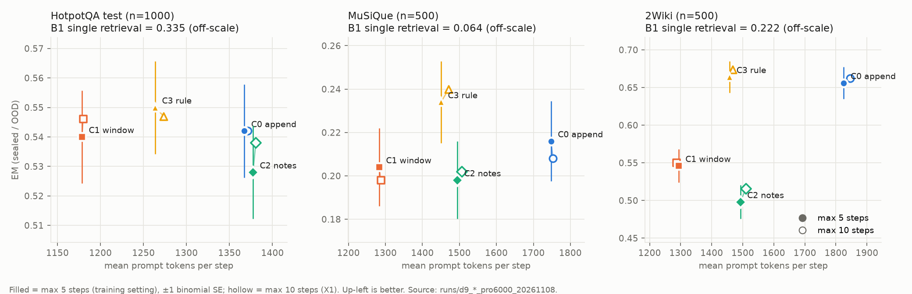
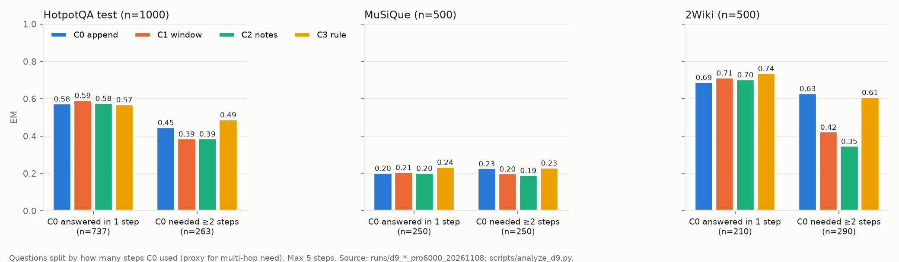
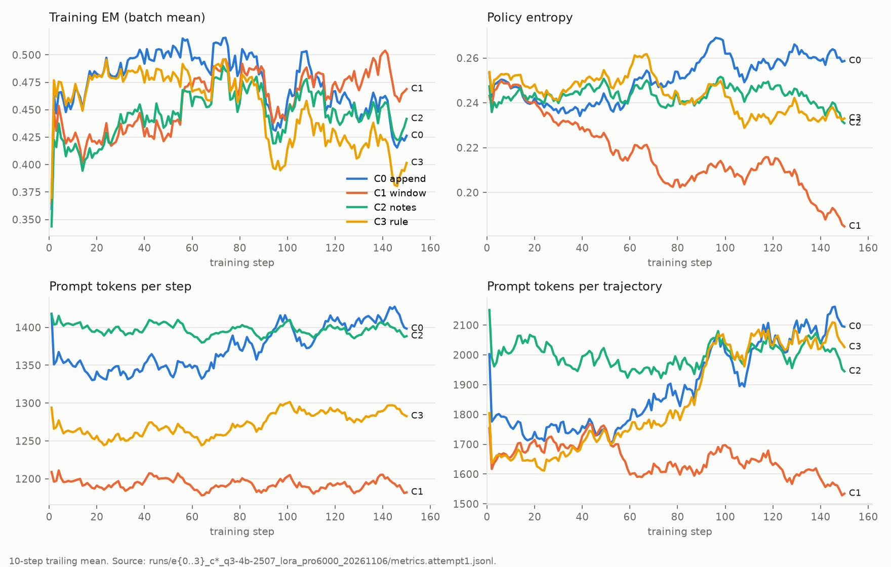
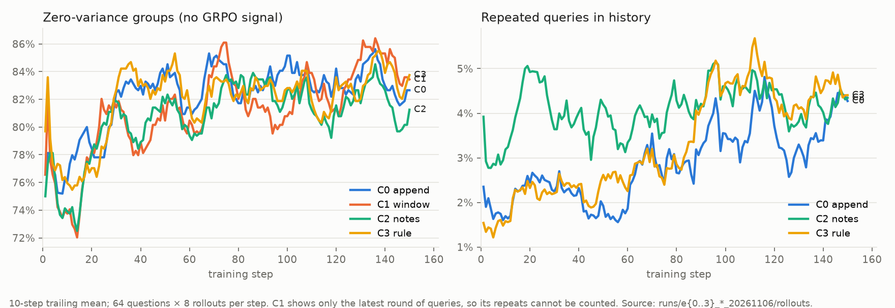

# StatefulSearch-RL 报告：多轮搜索 Agent 的上下文管理能否由 RL 学会？

> 版本：2026-11-08 初稿。所有数字来自 `runs/<run_id>/` 的日志，括号或表注里标出 run_id 或对应实验卡；费用为估算，以账单为准。
> 主要材料：实验卡 `docs/experiment_cards/`（`e0_e3_main.md`、`d9_sealed_eval.md`、`d10_rq2_note_quality.md` 等）、分析 `docs/analysis/d10_analysis.md`、图 `docs/figures/`。

## 摘要

在多跳搜索 Agent 的 GRPO 训练中，我们把「每一步的上下文怎么构造」作为唯一变量，比较四种策略：C0 append（原样累积全部历史文档）、C1 sliding window（只保留最近一轮）、C2 curate（只保留最近一轮 + 模型用 `note` 工具自己写的证据笔记）、C3 rule（只保留最近一轮 + 按规则从更早文档里抽的关键句）。基座为 Agent-R1（veRL 0.7.0，step-level），模型 Qwen3-4B-Instruct-2507 + LoRA，奖励只用 EM，四组超参、数据、步数完全相同，各训练 150 步。

主要发现：

1. **HotpotQA 封存测试（1000 题）上四组 EM 持平**（0.528–0.550，Bonferroni 校正后配对检验均不显著）。原因是约 74% 的题 C0 一步就作答，这部分题上上下文策略不起作用，四组打平。
2. **差距几乎全部出在需要跨轮拼证据的题上。** 按 C0 的步数分层，≥2 步的子集里 C1/C2 明显落后（HotpotQA 0.388 vs C0 0.449 / C3 0.490；2Wiki 0.42 / 0.35 vs 0.63 / 0.61）。在多数题需要多轮的 2Wiki 上，C1、C2 比 C0、C3 低 11–17pp（McNemar p < 1e-7）。四组之间只有「旧证据保不保留」这一个变量，所以差距由丢掉旧证据造成；失败轨迹显示了具体机制：重复检索、步数耗尽未作答。
3. **规则压缩 C3 与 C0 的 EM 持平（配对检验不显著），每步上下文短 7.5%（HotpotQA）/ 17%（MuSiQue）/ 20%（2Wiki）。** 但 C3 多搜了一些轮次（HotpotQA 平均 1.61 步 vs C0 1.42），**按每题总 prompt token 算，只在 2Wiki 上更省（−11%），在 HotpotQA / MuSiQue 上反而多 5–6%**。每题总量最省的是 C1（少 18–23%），代价是多轮题掉分。
4. **只用 EM 奖励时，RL 没有教会模型自己记笔记。** C2 有笔记的训练轨迹比例从 10.6%（第 1–10 步）降到 4.4%（第 141–150 步）；笔记本身一直基本忠实（明确幻觉约 2%），RL 后更贴原文（faithful 0.72 → 0.81），但引用段落命中官方 supporting fact 所在文档的比例下降（0.86 → 0.75）。C2 因此接近「窗口 + 很少用的工具」，在多轮题上与 C1 一样掉分。
5. **放宽步数上限（5 → 10）不能弥补丢证据**：检索轮数上升，但 EM 变化都在 ±1.8pp 内，组间差距不变。

结论一句话：在这个设定下（单 seed、4B、LoRA、150 步），**保住旧证据是多轮题准确率的关键；规则压缩在不掉分的前提下缩短了每步上下文，但多搜的轮次抵消了大部分总 token 节省；仅靠结果奖励，RL 没有学会提炼证据**，需要过程信号或冷启动（E4 / E5 的设计见 `docs/experiment_cards/e4_e5_candidates.md`）。

## 1. 问题与设计

### 1.1 研究问题（PLAN §2）
- RQ1：四种策略的 EM–token 帕累托关系。
- RQ2：RL 前后，C2 笔记的质量是否提升。
- RQ3：在更多跳的 MuSiQue / 2Wiki 上、或放宽最大步数时，策略差距是否拉大。
- RQ4：训练动力学（零方差组、熵、检索次数、重复检索）。

### 1.2 为什么必须是 step-level
每一步的上下文都可能被策略改写（截断、换成笔记），第 t 步动作真正的条件输入和「一条轨迹拼成一个序列」不一致，用拼接序列重算 logprob 会出错。Agent-R1 以 step 为样本单位、由环境构造下一步的 observation，正好满足这个要求；我们只替换每一步 prompt 的渲染函数（`src/ssrl/context_policies.py`），不改上游训练逻辑。

### 1.3 四种策略（`src/ssrl/context_policies.py`）
| 策略 | 每一步 prompt 里的证据 |
|---|---|
| C0 append | 全部历史检索文档（去重累积），与上游 recipe 逐字一致（有对拍单测） |
| C1 window | 只有最近 1 轮的文档 |
| C2 curate | 最近 1 轮的文档 + 模型用 `note` 工具写的笔记（每步最多 3 条、每条 ≤300 字符，须引用当前可见文档编号） |
| C3 rule | 最近 1 轮的文档 + 从更早文档里按与问题的词重叠抽出的关键句（每步最多 6 句） |
所有组的历史查询列表（History Actions）相同（C1 只显示最近一轮），写笔记不额外占步数。

### 1.4 训练设定（`docs/experiment_cards/e0_e3_main.md`，开跑前冻结）
- 数据：Agent-R1 recipe 的 HotpotQA train；dev_select 500 题选 checkpoint；test 1000 题封存（与 dev 互斥，D1 切分后未使用直到 D9）；OOD MuSiQue 500 / 2Wiki 500（只评测）。
- recipe 默认环境：每题最多 5 步、一步 ≤4 个并行检索、top-k=5、首步自动检索（`force_first_search`）。检索器 bge-large-en-v1.5 + FAISS Flat。
- GRPO：每步 64 题 × 8 条，150 步，LoRA r32 / α32 / all-linear，lr 1e-5，不加 KL，`seq-mean-token-mean`；奖励 = 训练奖励函数的 EM。
- 硬件：AutoDL RTX PRO 6000 96GB，每组 1 卡、两组并行；每组约 16.5–18 小时。
- 选择规则：dev EM 最高的 step（不含 step 0），并列取更早。选中：C0 step 80（dev 0.526）、C1 step 150（0.524）、C2 step 150（0.512）、C3 step 140（0.524）。

### 1.5 正确性保障
- **训推 logprob 一致性**（`d2_logprob_q3-4b-2507_20261103`）：同一组 token 上 vLLM 采样 logprob 与 HF bf16 前向重算的 |Δlogp| 均值 0.0101、中位数 1.2e-7、p99 0.215，有符号均值 0.0016，无系统性偏差。训练中 `rollout_probs_diff_mean` 约 0.006。
- **逐步优势广播**：`tests/test_step_advantage.py`（与上游 `compute_grpo_outcome_advantage` 对拍）；C0 渲染与上游逐字一致的对拍单测；本地单测 46 项通过（`d3_policies_tput.md`）。
- **轨迹严格回放**：每组冒烟后 `check_replay.py` 全部 PASS（`d3_smoke_c{0..3}_q3-0p6b_lora_pro6000_20261105`）。
- **续训一致性**：`check_resume.py` PASS（D3、2 卡预检）。

## 2. 主结果（D9 封存评测，`docs/experiment_cards/d9_sealed_eval.md`）

评测走与训练时 dev 评测完全相同的代码路径（`val_only` + 加载选中 adapter），greedy。正式评测前的一致性检查：C0 step 80 在 dev 上复测 0.508（训练时 0.526，预设门槛 ±2pp，通过；逐题 159/500 输出逐字一致，对→错 10、错→对 1，可由选择偏差 + vLLM 非确定性解释，新旧环境等价性未证实，因此 1–2pp 的组间差不作解读）。

### 2.1 EM 与 token（5 步上限；EM 为训练奖励函数口径，OOD 计入数据集给的答案别名）
| 数据集 | C0 append | C1 window | C2 notes | C3 rule | B0 无检索 | B1 单次检索 |
|---|---|---|---|---|---|---|
| HotpotQA test（1000） | 0.542 / 1367 | 0.540 / 1179 | 0.528 / 1377 | **0.550 / 1264** | 0.116 | 0.335 |
| MuSiQue（500） | 0.216 / 1748 | 0.204 / 1283 | 0.198 / 1494 | **0.234 / 1450** | 0.018 | 0.068 |
| 2Wiki（500） | 0.656 / 1825 | 0.546 / 1293 | 0.498 / 1492 | **0.664 / 1458** | 0.252 | 0.280 |

格式：EM / 每步平均 prompt token。run_id：`d9_<数据集>_<组>_q3-4b-2507_lora_pro6000_20261108`、`d9_b0b1_<数据集>_q3-4b-2507_pro6000_20261108`。只对 `ground_truth` 的 EM 和 token F1 见实验卡「答案指标」：HotpotQA 和 2Wiki 上三种口径的组间排序一致；MuSiQue 上 C1 与 C2 的先后随口径互换（相差 ≤ 0.6pp，在噪声内）。

图中横轴是**每步**平均 prompt token。按**每题**累计（各步之和）看，结论不同（`python -I scripts/analyze_d9.py runs` 末段）：

| 每题 prompt token 总量 / 平均步数 | C0 | C1 | C2 | C3 |
|---|---|---|---|---|
| HotpotQA test | 1959 / 1.42 | 1613 / 1.36 | 2021 / 1.46 | 2063 / 1.61 |
| MuSiQue | 3382 / 1.98 | 2592 / 2.04 | 2931 / 1.99 | 3586 / 2.53 |
| 2Wiki | 3350 / 1.94 | 2743 / 2.11 | 3431 / 2.29 | 2972 / 2.07 |

C3 每步更短，但会多搜几轮，每题总量在 HotpotQA / MuSiQue 上比 C0 多 5–6%，只在 2Wiki 上少 11%。如果关心的是单次调用的上下文长度（显存、延迟上限），C3 更优；如果关心每题总推理成本，C3 只在 2Wiki 上占优，C1 最省但多轮题掉分。

### 2.2 显著性（同题配对 McNemar，双侧精确检验；6 组比较，Bonferroni 阈值约 0.008）
| | C0 vs C1 | C0 vs C2 | C3 vs C1 | C3 vs C2 | C3 vs C0 | C1 vs C2 |
|---|---|---|---|---|---|---|
| HotpotQA test | 0.91 | 0.15 | 0.36 | 0.030 | 0.43 | 0.18 |
| MuSiQue | 0.47 | 0.22 | 0.058 | 0.013 | 0.21 | 0.71 |
| 2Wiki | 3.6e-8 | 1.5e-14 | 4.1e-9 | 6.4e-15 | 0.67 | 0.0056 |
校正后显著的只在 2Wiki 上：C1、C2 落后于 C0、C3，且 C2 落后于 C1。

### 2.3 差距出在哪里（RQ3）
按 C0 在该题用的步数分层（多跳需求的近似）：

| 数据集 | C0 一步作答（C0 / C1 / C2 / C3） | C0 ≥2 步 |
|---|---|---|
| HotpotQA test | 0.575 / 0.594 / 0.578 / 0.571（n=737） | 0.449 / 0.388 / 0.388 / 0.490（n=263） |
| MuSiQue | 0.204 / 0.208 / 0.204 / 0.236（n=250） | 0.228 / 0.200 / 0.192 / 0.232（n=250） |
| 2Wiki | 0.690 / 0.714 / 0.705 / 0.738（n=210） | 0.631 / 0.424 / 0.348 / 0.610（n=290） |

- C0 一步作答的题上四组打平；差距几乎全部在 C0 需要多步的题上（分层用 C0 的步数近似多跳需求）。HotpotQA 官方「比较」题上 C1/C2 不掉分（一次检索通常就拿到两个实体），2Wiki 的比较题（如「哪部电影的导演先去世」）要先查导演、再查各自生卒，必须跨轮——**决定差距的是需要几轮检索，而不是题型**。
- 失败方式（2Wiki）：用满 5 步 C0 38 / C1 84 / C2 106 / C3 59；没给出答案 44 / 91 / 104 / 48。C2 的检索历史里有 182 次逐字重复的查询（C0 76 次）。典型例子：C2 先查 "Kodi Ramakrishna death date"，转去查另一位导演后又把同一条查了一遍，步数用完；C0 两步答对。
- 放宽到 10 步：检索轮数上升（C3 在 MuSiQue 2.72 → 3.59），EM 变化 ±1.8pp 以内，组间差距不变。

## 3. RL 有没有学会提炼证据（RQ2，`docs/experiment_cards/d10_rq2_note_quality.md`）

从 E2 的训练 rollouts、dev 输出和 D9 输出抽出全部 note 调用及其引用段落（`runs/d10_rq2_note_quality_20261108`），自动指标看是否引用 HotpotQA 官方 supporting fact、是否含标准答案；LLM judge 判 faithful（是否被引用段落支持）/ relevant（是否记录了答题所需信息）。DeepSeek-V4.1-Flash 判全部 751 条；Gemini 3.8 Flash 判了 630 条（之后项目访问被 Google 限制）。两个 judge 一致率：faithful 0.97（kappa 0.92）、relevant 0.96（kappa 0.77）。另由 Claude 在看到 judge 结果前对 30 条做了盲审（第三个模型，不是人工标注），与两个 judge 的一致率 0.87–1.00。

| 训练中的笔记 | 第 1–10 步 | 第 141–150 步 |
|---|---|---|
| 笔记条数（每 5120 条轨迹） | 646 | 236 |
| 送 judge 的条数 | 400（按设定随机抽样） | 236（全部） |
| faithful = yes | 0.72（0.67–0.76） | 0.81（0.75–0.85） |
| 明确幻觉（faithful = no） | 0.022 | 0.025 |
| relevant = yes | 0.93（0.90–0.95） | 0.85（0.80–0.89） |
| 引用段落属于官方 supporting fact 文档 | 0.86（0.83–0.88） | 0.75（0.69–0.80） |
| 笔记含标准答案 | 0.62 | 0.54 |

「引用 supporting fact」是自动指标：笔记引用的段落标题是否属于 HotpotQA 标注的支撑文档，不等于笔记覆盖了关键事实本身。

- **笔记质量本来就不差，RL 没有让它变好，主要让模型「少写、写得更保守」**：更贴原文，但引用支撑文档的比例下降。
- 写了笔记的轨迹 EM 反而更低（D9 test 0.29 vs 0.54，平均 2.6 步）：笔记多出现在难题上。只用 EM 奖励时，GRPO 组内比较把「写笔记」和「答错」联系起来，可能是笔记率下降的原因（相关性证据）。

## 4. 训练动力学（RQ4）

- **C1 的策略熵持续下降**（约 0.25 → 0.18，其余三组稳定在 0.23–0.26），每条轨迹 prompt 总量下降，dev 检索轮数 1.59 → 1.41：窗口丢旧证据时多搜不划算，RL 把 C1 推向「少搜、早答」。能保住旧证据的 C0 / C3 后期反而越搜越多（dev 轮数 C0 1.37 → 1.60，C3 1.36 → 1.73）。
- **零方差组**（同题 8 条全对或全错，GRPO 无梯度）四组都从约 75% 升到约 83%，即后期每步 64 题只有约 11 题提供梯度，与 dev EM 在第 60–80 步后走平一致；四组走势相同，不是组间差异的来源。D2 的训练前 probe 已预示这一点：C0 起点 mixed 组只有 21.3%（`d2_probe_c0_q3-4b-2507_20261103_1100`）。
- 训练分布内重复检索率三组相近（约 2% → 4%）；C2 在 2Wiki 上的大量重复是分布外才暴露的。

## 5. 工程记录

- **单组 2 卡只快 1.19 倍**（`e0_c0_q3-4b-2507_lora_2gpu_pro6000_20261106`）：update_actor 快约 1.45 倍，但 rollout（约占每步一半）受最慢一条 4–5 轮串行轨迹限制，加 vLLM 副本不缩短；按 Amdahl 定律整体上限约 1.35–1.4 倍。据此改为每组 1 卡、多组并行；按实测吞吐估算，同等步数的 GPU 成本约降 40%（不是两种方案完整对照的账单结果）。
- **修复 Agent-R1 多卡路径的三个问题**（`third_party/patches/`）：全填充 micro-batch 上 rollout-corr 断言崩溃、各卡指标条数不一致导致 `reduce_metrics` 报错、rollout dump 混入填充复制行。已向上游提交 [AgentR1/Agent-R1#113](https://github.com/AgentR1/Agent-R1/pull/113)、[AgentR1/Agent-R1#114](https://github.com/AgentR1/Agent-R1/pull/114)。
- **评测中的问题与处理**（`d9_sealed_eval.md`）：2Wiki 的 23GB Flat 索引每个检索 worker 各载一份，页缓存累积后容器内存触顶、worker 被杀；清页缓存后按原配置重跑成功，失败的 attempt 未产出结果。
- 费用（估算）：E0–E3 正式训练约 70 卡时；D9 评测约 7.8 卡时；外部 judge 约 ¥0.3（DeepSeek）+ Gemini 赠金。

## 6. 局限与威胁

- token 成本有两种口径：每步上下文长度 C3 明显更短；每题总量 C3 只在 2Wiki 上更省（见 §2.1）。帕累托图用的是每步口径。
- **单 seed**。组间结论主要依赖 2Wiki 上 10pp 以上、p < 1e-7 的差距；HotpotQA / MuSiQue 上 1–2pp 的差距不应解读。
- 多跳分层用的是 C0 的步数（近似），2Wiki 题型为启发式划分。
- 评测环境与训练环境（驱动版本）不同，dev 复测低 1.8pp，在预设门槛内但等价性未证实。
- C2 的结论限于「只用 EM 奖励、4B、LoRA、150 步」。笔记工具的设计（每步上限、必须引用当前可见文档）本身也影响学习难度。
- HotpotQA 约 74% 的题一步可答，训练信号里需要跨轮记忆的题只占约四分之一，这本身限制了任何上下文策略能学到的东西。
- 实验卡对 OOD 主指标的文字描述（「只对 ground_truth」）与实际奖励函数（计入答案别名）不一致，已在卡中更正并同时报告两种口径。

## 7. 后续

- **E4：C2 + 笔记奖励**（答对且多轮时，按笔记引用 supporting fact 的比例给小额奖励，设上限防钻空子）。
- **E5：C2 + SFT 冷启动**（用会写笔记的示范轨迹先做轻量 SFT，再只用 EM 训练）。
- 设计与判读规则已写定，见 `docs/experiment_cards/e4_e5_candidates.md`；E4 / E5 都只与 E2 比、只改一个变量。

## 附：复现

见 `README.md`「复现」一节；分析脚本：`scripts/analyze_d9.py`、`scripts/plot_d9.py`、`scripts/plot_dynamics.py`、`scripts/rollout_dynamics.py`、`scripts/rq2_note_quality.py`。
